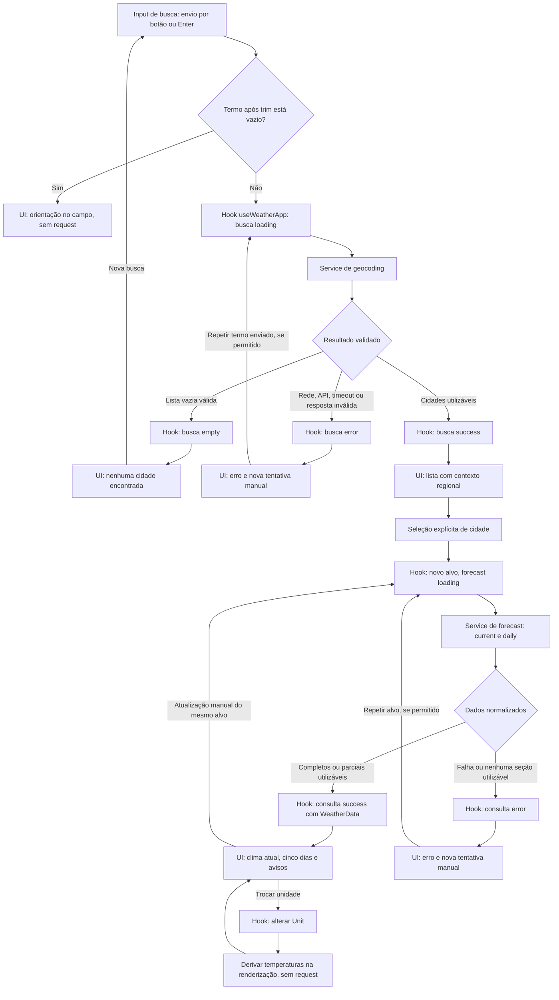

# Weather App — Plano Técnico

Fonte da verdade: [weather-app-spec.md](../specs/weather-app-spec.md). Este documento define decisões e contratos, não a implementação final. O escopo continua sendo o MVP não comercial, sem backend, autenticação, cache persistente ou SLA. A implementação depende da próxima etapa de Tasks.

## Architecture

Uma SPA de tela única com quatro responsabilidades: apresentação (`components/`), orquestração/estado (`hooks/`), acesso a dados (`services/`) e transformações puras (`lib/`). `types/` contém somente contratos compartilhados. Sem router, estado global de terceiros, backend intermediário, repositórios ou hierarquias de adaptadores.

```text
main.tsx → App.tsx (composição)
              ├─ components/ (props e callbacks)
              └─ hooks/ → services/ → Open-Meteo / APIs do navegador
                    └─ lib/ ← services/ e components/

types/ ← contratos usados pelas demais camadas
```

As setas representam dependências de importação, não o retorno de dados. `App` chama o controlador e distribui estado e ações; os componentes de apresentação não precisam importar hooks de domínio.

| Decisão | Responsabilidade e rastreabilidade |
|---|---|
| Uma tela sem navegação por coordenadas ou cidade | Busca, seleção, consulta e preferências no mesmo fluxo; evita expor localização na URL. RF-01 a RF-08, RNF-06. |
| Componentes recebem dados normalizados | Não conhecem JSON do provedor nem fazem fetch. RF-02/RF-03, EC-10 a EC-14. |
| Controlador local coordena efeitos e intenções | Busca independente da consulta meteorológica; respostas antigas não substituem intenção vigente. RF-05/RF-08, EC-15 a EC-17, EC-32/EC-33. |
| Serviços como funções diretas | Cada serviço concentra uma API externa ou recurso do navegador; sem classe, repository ou adaptador extra. Validação pura é reutilizada de `lib/`. RF-01/RF-05/RF-06/RF-07. |
| Funções puras separadas dos efeitos | Normalização, datas e unidades recebem entradas explícitas e retornam resultados sem rede, armazenamento ou relógio implícito. RF-02/RF-03/RF-04/RF-08. |
| Estado meteorológico somente em memória | Atualização com erro pode preservar dados da mesma localização, sem persistir previsão. RF-05/RF-08, EC-25/EC-26. |

`App` compõe busca, resultados, controles de unidade/localização/atualização, preferências lembradas, condições atuais, cinco cartões diários e mensagens. Componentes de aviso/atribuição são compartilhados, sem modal desnecessário. HTML semântico, foco estável e estados anunciados são parte da arquitetura de apresentação, não acabamento posterior (RNF-01/RNF-02).

### Dependências permitidas

| Origem | Pode importar | Não pode importar/acessar diretamente |
|---|---|---|
| `main.tsx` | `App`, estilos e React para inicialização. | Serviços e regras de negócio. |
| `App.tsx` | Componentes, hook controlador e tipos; helpers puros se necessários à composição. | Fetch, geolocalização e armazenamento. |
| `components/` | Outros componentes, `lib/`, `types/` e React para interação visual. | `hooks/` de domínio, `services/`, fetch, geolocalização e armazenamento. |
| `hooks/` | `services/`, `lib/`, `types/`, React e módulos locais de estado. | `components/`, `App` ou detalhes de marcação. |
| `services/` | `lib/`, `types/` e helper HTTP interno compartilhado pelos serviços de rede. | React, hooks, componentes e importações entre serviços de domínio para coordenar fluxos. |
| `lib/` | `types/` e helpers puros locais em uma única direção. | React, hooks, serviços, DOM, rede, armazenamento e leitura implícita do relógio. |
| `types/` | Outros contratos de tipos, sem ciclos. | Qualquer módulo executável de outra camada. |

Usar `import type` para contratos; tipos não iniciam efeitos. A composição de serviços pertence aos hooks: por exemplo, `geolocation.ts` não chama `forecast.ts`. `http.ts` não importa serviços de domínio. O reducer pode permanecer em `hooks/` por coesão com o estado, mas é puro e importa somente tipos e helpers puros.

Evitar arquivos `index.ts` que reexportem camadas inteiras e ciclos ocultos. Extrair helper para `lib/` somente quando for uma regra pura ou reutilizada, não para criar uma função intermediária sem responsabilidade. Revisão de imports verifica essas fronteiras; não adicionar ferramenta de arquitetura ao MVP.

### Testabilidade, segurança e manutenção

- **Apresentação:** testes com props e callbacks controlados verificam conteúdo, teclado e anúncios sem rede ou armazenamento. Alterar layout não modifica contratos HTTP.
- **Orquestração:** testar reducer/hook com serviços substituídos, relógio explícito e promessas controladas; validar timeout, intenção mais recente e exclusão com resposta pendente sem depender do DOM completo.
- **Acesso a dados:** testar serviços com fetch, geolocalização e armazenamento simulados; conferir parâmetros, classificação de falhas e persistência mínima em uma única fronteira de efeitos.
- **Regras puras:** tabelas de entradas/saídas para datas, códigos WMO, `null`/zero e arredondamento; executar sem React, navegador ou API real.
- **Segurança:** serviços recebem JSON como `unknown`; `lib/` valida e normaliza antes de alcançar a UI. Coordenadas ficam somente no estado transitório e na requisição autorizada; projeção de preferências impede serializar dados meteorológicos ou coordenadas. Não registrar entrada sensível nem renderizar HTML externo.
- **Manutenção:** cada regra tem um responsável. Sem cópias da conversão em componentes, normalização em hooks ou persistência em efeitos genéricos. Mudanças no provedor afetam serviços/normalização; mudanças de UX afetam componentes e coordenação.

## Tech Stack

Usar versões já declaradas em `package.json` e o lockfile; não atualizar dependências nesta fase.

| Tecnologia | Justificativa | Requisitos |
|---|---|---|
| TypeScript strict | Tipos discriminados e validação de dados externos como `unknown`; sem `any`. | RF-02/RF-03/RF-05, RNF-06. |
| React + Vite | SPA pequena e build estático; sem SSR ou framework adicional. | RF-01 a RF-08, RNF-03. |
| Tailwind CSS | Tema dark glassmorphism conforme convenção do projeto, com contraste verificável e layout responsivo. | RNF-01/RNF-02. |
| Fetch, AbortController, URL/URLSearchParams | Integração direta, timeout e encoding sem SDK ou cliente HTTP adicional. | RF-01/RF-05, EC-03/EC-07. |
| Intl.DateTimeFormat / Intl.NumberFormat | pt-BR, fuso IANA e exibição localizada sem biblioteca de datas inicialmente. | RF-03/RF-04/RF-08, RNF-05. |
| Geolocation API e localStorage | Localização sob ação explícita e somente preferências mínimas persistidas. | RF-06/RF-07. |
| Vitest + Testing Library; Playwright | Funções, componentes e fluxos reais com respostas controladas. | Todos os CA/EC e RNFs. |
| pnpm + Biome | Fluxo existente de dependências, lint e formatação. | Manutenibilidade e checklist de entrega da spec. |

Não adicionar Redux, biblioteca de cache, service worker, geocodificação reversa, biblioteca de componentes ou validação de schema como dependência por padrão. Guards pequenos e funções puras cobrem o contrato atual; reavaliar somente com necessidade comprovada.

## Project Structure

Estrutura proposta; arquivos serão criados apenas nas fases Code/Test:

```text
src/
  App.tsx
  main.tsx
  index.css
  components/
    CitySearch.tsx
    CityResults.tsx
    LocationButton.tsx
    TemperatureToggle.tsx
    PreferencesPanel.tsx
    WeatherPanel.tsx
    CurrentWeather.tsx
    ForecastCard.tsx
    ForecastList.tsx
    QueryFeedback.tsx
    WeatherAttribution.tsx
    states/
      LoadingState.tsx
      ErrorState.tsx
      EmptyState.tsx
  hooks/
    useWeatherApp.ts
    weatherReducer.ts
  services/
    http.ts
    geocoding.ts
    forecast.ts
    geolocation.ts
    preferences.ts
  types/
    weather.ts
    errors.ts
    state.ts
  lib/
    validation.ts
    normalizeWeather.ts
    dates.ts
    temperature.ts
    format.ts
    weatherCodes.ts
tests/
  unit/
  components/
  e2e/
  fixtures/
```

| Pasta/arquivo | Responsabilidade |
|---|---|
| `components/` | Renderização semântica, estados visuais e callbacks. `WeatherPanel` compõe cartões; `QueryFeedback` apresenta mensagens; `WeatherAttribution` concentra créditos e aviso de estimativas. |
| `hooks/useWeatherApp.ts` | Coordena busca, seleção, localização, atualização, preferências e timers de apresentação; expõe estado e ações a `App`. |
| `hooks/weatherReducer.ts` | Transições puras e invariantes do estado, sem efeitos. |
| `services/http.ts` | Transporte comum: HTTPS, deadline, status e leitura segura da resposta. Sem estado React ou regras de seleção. |
| `services/geocoding.ts`, `forecast.ts` | Parâmetros e interpretação dos contratos externos, usando validação/normalização de `lib/`. |
| `services/geolocation.ts`, `preferences.ts` | Acesso exclusivo às APIs do navegador, falhas explícitas e armazenamento mínimo. |
| `lib/validation.ts`, `normalizeWeather.ts` | Validação de estruturas/domínios e transformação pura do JSON em modelo interno. |
| `lib/dates.ts`, `temperature.ts`, `weatherCodes.ts` | Calendário/fusos e atualidade com `now` fornecido; conversão/arredondamento; mapeamento WMO. |
| `types/` | Contratos de clima, falhas e estado, sem dependências executáveis. |
| `App.tsx`, `main.tsx`, `index.css` | Composição, inicialização e estilos globais mínimos, respectivamente. |

Um componente por arquivo. Relógio e chamadas são fornecidos nos pontos de efeito para controle nos testes. A árvore é um mapa de responsabilidades, não uma exigência de criar arquivos vazios: dividir apenas módulos com responsabilidade concreta. Nenhuma pasta `utils/` paralela a `lib/`, evitando dois destinos para as mesmas regras puras. Não criar classes ou interfaces de infraestrutura sem consumidor concreto.

`ForecastList` recebe `forecast: readonly ForecastDay[]` e `unit: Unit`, compondo um `ForecastCard` por data em `grid-cols-2 sm:grid-cols-3 lg:grid-cols-5`. Cada card recebe `day` e `unit`; `lib/format.ts` fornece o rótulo absoluto pt-BR (dia da semana e data completa) sem consultar relógio ou converter a data local para o fuso do dispositivo. A lista vazia informa seção indisponível, sem fabricar dias; a normalização continua responsável pelo contrato de cinco dias. Avisos de período anterior ficam na composição `WeatherPanel`.

## Data Model

Integração manual em `App`: substitui o protótipo com mock e seletor de demonstração
por `useWeather`, inicialmente idle e sem requests. `QueryFeedback` apresenta
busca/loading/vazio/erro e resultados com seleção explícita; `WeatherPanel`
apresenta loading/erro/snapshot, resposta parcial e conclusão no fuso recebido
(UTC rotulado quando indisponível). `ErrorState` chama `retry`, move foco somente
na ação explícita e desabilita recuperação obsoleta ou bloqueada. Prazo de
rate limit expira no hook sem retry automático. `unit` continua estado local
de UI, convertido na renderização sem rede; persistência aguarda sua entrega.

Hardening do protótipo: após retry explícito que remove seu botão, focar o `main` estável; respostas de busca não deslocam foco. Controles de unidade têm alvo mínimo de 44 × 44 CSS px e bordas dos campos devem contrastar ao menos 3:1 com o fundo adjacente. `tests/e2e/accessibility.spec.ts` verifica os cinco estados em 320/390/768/1366/1920 px, scanner WCAG A/AA, navegação por teclado, toque e reflow com texto a 200%. Anúncios percebidos por leitor de tela continuam exigindo validação manual.

Durante loading, o formulário de busca e a região de dados meteorológicos expõem `aria-busy` independentemente; os anúncios de carregamento ficam fora dessas áreas para não serem adiados. O campo permanece editável e a unidade operável. Hover só se aplica a botões habilitados; a orientação de retry é associada por `aria-describedby`. Não adicionar memoização sem custo observado.

Contratos TypeScript propostos; declarações não representam código de produção. Campos numéricos de domínio são finitos e validados, mantidos na precisão de origem. `null` significa indisponível, nunca zero.

```ts
type Unit = 'celsius' | 'fahrenheit'; // Preferência de apresentação.
type LocalDate = string; // Data local válida no formato YYYY-MM-DD.
type EpochMs = number; // Instante em milissegundos desde Unix epoch.
type IanaTimeZone = string; // Nome de fuso validado, como America/Bahia.

interface Coordinates {
  latitude: number; // Latitude WGS84 em graus.
  longitude: number; // Longitude WGS84 em graus.
}

interface CityIdentity {
  name: string; // Nome retornado pelo geocoding.
  region: string | null; // Região/estado, proveniente de admin1.
  country: string | null; // País, quando disponível.
}

interface City extends CityIdentity {
  id: number; // Identificador da localidade no geocoding.
  coordinates: Coordinates; // Coordenadas para consultar a previsão.
  timeZone: IanaTimeZone | null; // timezone do geocoding, se válido.
}

type WeatherLocation =
  | { kind: 'city'; city: City }
  | { kind: 'device'; coordinates: Coordinates };

type WeatherCode =
  | 0 | 1 | 2 | 3 | 45 | 48 | 51 | 53 | 55 | 56 | 57
  | 61 | 63 | 65 | 66 | 67 | 71 | 73 | 75 | 77
  | 80 | 81 | 82 | 85 | 86 | 95 | 96 | 99;

interface CurrentWeather {
  temperatureC: number | null; // current.temperature_2m, em Celsius.
  apparentTemperatureC: number | null; // current.apparent_temperature, em Celsius.
  weatherCode: WeatherCode | null; // current.weather_code reconhecido (WMO).
  relativeHumidityPct: number | null; // current.relative_humidity_2m, em %.
  windSpeedKmh: number | null; // current.wind_speed_10m, em km/h.
  precipitationMm: number | null; // current.precipitation, em mm no intervalo atual.
  pressureMslHpa: number | null; // current.pressure_msl, pressão ao nível do mar.
  referenceTimeMs: EpochMs | null; // current.time normalizado; não é medição de estação.
}

interface ForecastDay {
  date: LocalDate; // daily.time: dia no calendário da localização.
  weatherCode: WeatherCode | null; // daily.weather_code: condição mais severa.
  minTemperatureC: number | null; // daily.temperature_2m_min, em Celsius.
  maxTemperatureC: number | null; // daily.temperature_2m_max, em Celsius.
  maxPrecipitationProbabilityPct: number | null; // daily.precipitation_probability_max, em %.
  meanRelativeHumidityPct: number | null; // daily.relative_humidity_2m_mean, em %.
  maxWindSpeedKmh: number | null; // daily.wind_speed_10m_max, em km/h; não é rajada.
}

interface WeatherData {
  location: WeatherLocation; // Alvo solicitado; não a coordenada da grade do modelo.
  timeZone: IanaTimeZone | null; // timezone validado da resposta de previsão.
  periodStart: LocalDate | null; // Primeiro dia do período recebido.
  current: CurrentWeather | null; // Condições atuais; null se seção indisponível.
  forecast: readonly ForecastDay[]; // Cinco dias ou [] sem período local válido.
  completedAtMs: EpochMs; // Conclusão da consulta utilizável, não horário do modelo.
  partial: boolean; // Indica campos ou seções indisponíveis.
}

interface Preferences {
  city?: CityIdentity; // Última cidade manual lembrada, sem ID ou coordenadas.
  unit?: Unit; // Unidade escolhida; ausente significa Celsius padrão.
}
```

`LocalDate` é validada como data real `YYYY-MM-DD`; `EpochMs` é um instante finito; `IanaTimeZone` deve ser aceito por `Intl`. Os aliases não substituem validação em runtime. Coordenadas devem estar em latitude −90 a 90 e longitude −180 a 180.

`Unit` representa a preferência da UI, não a unidade dos campos de origem: os campos com sufixo `C` permanecem em Celsius. Na fronteira de armazenamento, mapear `celsius`/`fahrenheit` para `C`/`F` e vice-versa, preservando o contrato de persistência da spec.

Invariantes (RF-02/RF-03/RF-07/RF-08):

- `City.id` e coordenadas existem apenas em memória. Persistir somente projeção explícita para `CityIdentity`, nunca serializar `City` ou `WeatherData`.
- Fuso válido e início de período conhecido produzem exatamente cinco `ForecastDay`, incluindo dias sem dados; fuso/período não determinável produz `forecast: []` e aviso de seção indisponível. Condições atuais válidas ainda podem ser exibidas.
- `current: null` significa seção sem campo meteorológico utilizável. Na previsão, placeholders não contam como campos utilizáveis. Sem campo utilizável em ambas as seções, retornar erro, não `WeatherData`.
- Temperaturas são Celsius de origem. Conversões e arredondamento ocorrem somente para apresentação. Código desconhecido vira condição indisponível e resposta parcial.
- Conferir unidades recebidas; valores em unidades ausentes ou incompatíveis não são presumidos como Celsius/km/h. Invalidar os campos afetados e sinalizar parcial.
- Arrays diários com tamanho diferente de `daily.time` invalidam somente a série afetada. Invalidar todas as posições de uma data duplicada; ignorar datas inválidas ou fora do período; não deslocar valores.
- Porcentagens fora de 0–100, vento/precipitação negativos, pressão ao nível do mar menor ou igual a zero e valores não finitos viram `null`. Zero permanece válido para temperatura, porcentagens, vento e precipitação; temperaturas negativas também são válidas. Não corrigir inconsistência entre mínima/máxima trocando os valores silenciosamente.
- Horário de sucesso é de resposta utilizável aceita pela intenção vigente. Consulta parcial nova substitui o snapshot da resposta anterior; não completar buracos com valores antigos.

Contratos de falha e serviços:

```ts
type ServiceName = 'geocoding' | 'forecast' | 'geolocation' | 'preferences';
type ErrorKind =
  | 'network' | 'http' | 'timeout' | 'rate-limit' | 'invalid-response'
  | 'permission-denied' | 'unavailable'
  | 'storage-read' | 'storage-write' | 'storage-remove' | 'unexpected';

interface AppError {
  kind: ErrorKind;
  service: ServiceName;
  retryAtMs: EpochMs | null;
  status: number | null;
}

type Result<T> =
  | { ok: true; value: T }
  | { ok: false; error: AppError };

interface RequestContext {
  signal: AbortSignal;
  now: () => EpochMs;
}

interface PreferenceRead {
  value: Preferences;
  discarded: readonly ('city' | 'unit')[];
}

interface CitySearchResult {
  cities: readonly City[];
  partial: boolean;
}

interface WeatherServices {
  searchCities(
    query: string, context: RequestContext
  ): Promise<Result<CitySearchResult>>;
  fetchWeather(
    location: WeatherLocation, context: RequestContext
  ): Promise<Result<WeatherData>>;
  locate(context: RequestContext): Promise<Result<Coordinates>>;
  readPreferences(): Result<PreferenceRead>;
  writePreferences(value: Preferences): Result<void>;
  clearPreferences(): Result<void>;
}
```

Assinaturas podem ser exportações de funções, sem implementar uma classe `WeatherServices`. Cancelamento por supersessão não é erro notificável: a camada coordenadora descarta o resultado por token/signal. Erros reais seguem `Result`; exceções inesperadas não viram listas vazias ou sucessos simulados. `AppError` não armazena query, URL, coordenadas, corpo da resposta nem mensagem bruta do provedor (RNF-06).

O controlador deve tratar rejeições inesperadas em cada ação assíncrona: se a intenção ainda estiver vigente, encerrar o loading com `unexpected`, mensagem recuperável e diagnóstico sanitizado apenas de categoria/serviço. Não registrar o objeto de exceção bruto, que pode conter URL ou coordenadas. Rejeição de operação superada não altera o estado atual. A fronteira de erro React não substitui esse tratamento.

## Data Flow

1. **Abertura (RF-07):** ler preferências, validar cada campo independentemente, restaurar unidade ou Celsius e mostrar cidade lembrada para confirmação. Nenhuma chamada de rede/localização. Falha de leitura é anunciada sem bloquear a tela.
2. **Busca (RF-01):** envio explícito, trim externo, validar vazio; iniciar intenção de busca, limpar resultados antigos e chamar geocoding. Exibir até dez resultados, sem seleção automática. Resultado vazio não é erro de rede.
3. **Seleção manual (RF-02/RF-03/RF-07):** registrar local escolhido, persistir somente sua identidade por ação explícita e iniciar uma consulta meteorológica. Escrita falha não bloqueia a consulta. Nova busca textual não invalida este fluxo.
4. **Localização (RF-06):** texto prévio explica Open-Meteo, IP/coordenadas e termos. Clique inicia nova intenção meteorológica; obter coordenadas com limite de 10 s e depois previsão com outro limite de 10 s. Usar “Sua localização”, sem reverse geocoding nem persistência da coordenada; conservar a última cidade manual lembrada.
5. **Normalização (RF-02/RF-03/RF-05):** serviço recebe JSON como `unknown`, valida envelope, unidades, fuso e séries; produz campos válidos, ausência explícita ou erro total. Só o controlador confirma o resultado se o token continuar vigente.
6. **Atualização (RF-08):** consultar novamente o alvo vigente; manter dados visíveis da mesma localização enquanto carrega e, em falha, marcar “Não atualizados”. Ao selecionar outro alvo, remover snapshot antigo da área de dados para não confundir localidades.
7. **Unidade (RF-04):** alterar preferência e apresentação local; persistir somente a preferência explicitamente alterada. Nenhuma nova requisição.
8. **Restaurar cidade (RF-07):** confirmar dispara busca por nome salvo; região/país são contexto visual para decisão, não heurística de seleção automática. Exigir seleção explícita mesmo com um único resultado.
9. **Apagar (RF-07):** remover somente chave própria; após sucesso, limpar identidade lembrada e unidade persistida, usar Celsius e manter consulta visível se houver. Respostas pendentes e atualização não escrevem preferências; nova escolha salva somente o campo escolhido.
10. **Passagem do tempo (RF-03/RF-08):** relógio local de apresentação, sem fetch periódico, recalcula idade e mudança de dia. Reavaliar ao retornar à aba; timers suspensos pelo navegador não disparam atualização meteorológica.

### Diagrama do fluxo de busca e consulta

As setas representam eventos e dados, não importações. O hook coordena as chamadas e aceita somente respostas da intenção vigente; componentes não acessam serviços diretamente. Busca e forecast mantêm estados independentes.



Nos caminhos de retry, respeitar bloqueio do serviço por `Retry-After`, prazo de 10 s por operação e ausência de repetição automática. Em refresh do mesmo alvo, preservar snapshot visível durante loading e, em falha, com “Não atualizados”; nova cidade não reutiliza dados da anterior. Forecast sem dados utilizáveis é erro, nunca `empty`. Respostas superadas não percorrem caminhos de sucesso ou erro da UI.

## External APIs

### Geocoding — RF-01

`services/geocoding.ts` implementa o contrato `Result<CitySearchResult>` acima;
`services/weatherService.ts` apenas reexporta a função para preservar o caminho
solicitado. `App` usa o hook para integrar busca e previsão reais. Cancelamento
externo rejeita com `AbortError` sanitizado, a ser descartado pelo controlador
conforme signal/token; não é convertido em `AppError` notificável.

`GET https://geocoding-api.open-meteo.com/v1/search`

| Parâmetro | Contrato |
|---|---|
| `name` | Termo com trim externo; URLSearchParams, sem concatenação manual. |
| `count` | `10`. |
| `language` | `pt`. |
| `format` | `json`. |
| País / chave | Não enviar `countryCode` ou API key. |

Resposta esperada: objeto JSON com `results` opcional. Ausência de `results` ou lista vazia em sucesso sem envelope de erro significa vazio documentado; tipo inválido ou `error: true` significa falha, nunca vazio.

Cada resultado precisa de nome, identificador e coordenadas válidos para consulta; campos opcionais ausentes viram `null`. Itens inválidos não ficam selecionáveis; informar resposta parcial de busca se houver itens descartados. Se havia resultados mas nenhum é utilizável, retornar `invalid-response`. Preservar ordem dos válidos, limitados a dez. Se rótulos nome/região/país forem indistinguíveis, sinalizar limitação nesses itens e pedir termo mais específico, sem autoescolha (EC-05).

Exemplo de URL:

`https://geocoding-api.open-meteo.com/v1/search?name=Berlin&count=10&language=pt&format=json`

Resposta ilustrativa resumida, com um resultado:

```json
{
  "results": [
    {
      "id": 2950159,
      "name": "Berlim",
      "latitude": 52.52437,
      "longitude": 13.41053,
      "admin1": "Berlim",
      "country": "Alemanha",
      "country_code": "DE",
      "timezone": "Europe/Berlin"
    }
  ]
}
```

| Resposta | Destino no modelo | Regra |
|---|---|---|
| `results[i].id`, `.name` | `City.id`, `City.name` | Validar identificador inteiro e nome não vazio. |
| `.latitude`, `.longitude` | `City.coordinates` | Validar coordenadas finitas e dentro dos limites WGS84. |
| `.admin1`, `.country` | `City.region`, `City.country` | Ausência vira `null`; não inferir região ou país. |
| `.timezone` | `City.timeZone` | Validar fuso IANA; ausência/inválido vira `null`. O forecast deve fornecer seu próprio fuso válido. |
| Lista de resultados | `CitySearchResult.cities` | Somente itens utilizáveis, na ordem recebida; `partial` indica descarte de itens inválidos. |

`country_code` não é persistido nem necessário ao modelo atual. `CityIdentity` é somente a projeção de `name`, `region` e `country`, sem ID, coordenadas ou fuso.

### Forecast — RF-02/RF-03/RF-08

`GET https://api.open-meteo.com/v1/forecast`

| Parâmetro | Valor |
|---|---|
| `latitude`, `longitude` | Coordenadas do resultado selecionado ou do dispositivo, somente na requisição ao provedor. |
| `current` | `temperature_2m,apparent_temperature,weather_code,relative_humidity_2m,wind_speed_10m,precipitation,pressure_msl`. |
| `daily` | `weather_code,temperature_2m_min,temperature_2m_max,precipitation_probability_max,relative_humidity_2m_mean,wind_speed_10m_max`. |
| `forecast_days` | `5`. |
| `timezone` | `auto`. |
| `temperature_unit` | `celsius`. |
| `wind_speed_unit` | `kmh`. |
| `precipitation_unit` | `mm`. |
| `timeformat` | `iso8601`: datas diárias mantidas como rótulos locais. |

Origem: `current`, `current_units`, `daily`, `daily_units`, `timezone`. JSON externo é `unknown`; não expor DTO bruto nos componentes.

Exemplo de URL para a cidade retornada pelo geocoding:

`https://api.open-meteo.com/v1/forecast?latitude=52.52437&longitude=13.41053&current=temperature_2m,apparent_temperature,weather_code,relative_humidity_2m,wind_speed_10m,precipitation,pressure_msl&daily=weather_code,temperature_2m_min,temperature_2m_max,precipitation_probability_max,relative_humidity_2m_mean,wind_speed_10m_max&forecast_days=5&timezone=auto&temperature_unit=celsius&wind_speed_unit=kmh&precipitation_unit=mm&timeformat=iso8601`

Resposta ilustrativa: demais metadados foram omitidos, mas os cinco dias e as unidades necessárias foram mantidos. Os valores não representam uma previsão real.

```json
{
  "latitude": 52.52,
  "longitude": 13.42,
  "timezone": "Europe/Berlin",
  "utc_offset_seconds": 3600,
  "current_units": {
    "time": "iso8601",
    "interval": "seconds",
    "temperature_2m": "°C",
    "apparent_temperature": "°C",
    "weather_code": "wmo code",
    "relative_humidity_2m": "%",
    "wind_speed_10m": "km/h",
    "precipitation": "mm",
    "pressure_msl": "hPa"
  },
  "current": {
    "time": "2026-10-29T14:00",
    "interval": 900,
    "temperature_2m": 12.3,
    "apparent_temperature": 10.1,
    "weather_code": 3,
    "relative_humidity_2m": 70,
    "wind_speed_10m": 15,
    "precipitation": 0.4,
    "pressure_msl": 1013
  },
  "daily_units": {
    "time": "iso8601",
    "weather_code": "wmo code",
    "temperature_2m_min": "°C",
    "temperature_2m_max": "°C",
    "precipitation_probability_max": "%",
    "relative_humidity_2m_mean": "%",
    "wind_speed_10m_max": "km/h"
  },
  "daily": {
    "time": ["2026-10-29", "2026-10-30", "2026-10-31", "2026-11-01", "2026-11-02"],
    "weather_code": [3, 61, 2, 3, 1],
    "temperature_2m_min": [8, 7, 6, 7, 5],
    "temperature_2m_max": [14, 12, 13, 11, 12],
    "precipitation_probability_max": [20, 70, 30, 40, 10],
    "relative_humidity_2m_mean": [70, 80, 65, 75, 60],
    "wind_speed_10m_max": [20, 25, 18, 22, 15]
  }
}
```

| Resposta | Destino no modelo | Regra |
|---|---|---|
| `current.temperature_2m` | `CurrentWeather.temperatureC` | Celsius validado; conversão somente na apresentação. |
| `current.apparent_temperature` | `CurrentWeather.apparentTemperatureC` | Sensação térmica, não mínima/máxima. |
| `current.weather_code` | `CurrentWeather.weatherCode` | Validar código WMO conhecido; desconhecido vira `null`. |
| `current.relative_humidity_2m` | `CurrentWeather.relativeHumidityPct` | Número de 0 a 100; zero é válido. |
| `current.wind_speed_10m` | `CurrentWeather.windSpeedKmh` | Velocidade não negativa em km/h. |
| `current.precipitation` | `CurrentWeather.precipitationMm` | Valor finito não negativo em mm; zero válido, não probabilidade diária. |
| `current.pressure_msl` | `CurrentWeather.pressureMslHpa` | Valor finito positivo em hPa; pressão ao nível do mar, não de superfície. |
| `current.time` | `CurrentWeather.referenceTimeMs` | Resolver instante no fuso retornado conforme regra abaixo; `interval` não é idade nem horário de conclusão da consulta. |
| `daily.time[i]` | `ForecastDay.date` | Data local válida; não converter para o fuso do dispositivo. |
| `daily.weather_code[i]` | `ForecastDay.weatherCode` | Condição mais severa prevista para o dia, segundo o provedor. |
| `daily.temperature_2m_min[i]`, `.temperature_2m_max[i]` | `ForecastDay.minTemperatureC`, `.maxTemperatureC` | Extremos diários em Celsius. |
| `daily.precipitation_probability_max[i]` | `ForecastDay.maxPrecipitationProbabilityPct` | Probabilidade máxima diária em %, não volume de chuva. |
| `daily.relative_humidity_2m_mean[i]` | `ForecastDay.meanRelativeHumidityPct` | Média diária fornecida pelo provedor, sem agregação local. |
| `daily.wind_speed_10m_max[i]` | `ForecastDay.maxWindSpeedKmh` | Vento máximo diário em km/h, não rajada. |
| `timezone` | `WeatherData.timeZone` | Fuso IANA válido; não substituir pelo fuso do dispositivo. |
| Período diário recebido | `WeatherData.periodStart`, `.forecast` | Cinco datas esperadas, com lacunas marcadas conforme a spec. |
| Campos atuais normalizados | `WeatherData.current` | `null` se nenhum campo meteorológico atual for utilizável. |
| Alvo enviado, não coordenadas da grade retornada | `WeatherData.location` | Preservar identidade da cidade selecionada ou alvo `device`. |
| Relógio no aceite da resposta utilizável | `WeatherData.completedAtMs` | Não existe no JSON; gerado pela aplicação somente para a intenção vigente. |
| Validação de campos e seções | `WeatherData.partial` | Derivado de ausências/invalidações, não de um campo do provedor. |

Validar cada campo contra sua unidade antes do mapeamento. Ausência, `null` ou valor inválido vira indisponibilidade explícita; se ambas as seções ficarem sem dados utilizáveis, retornar erro. A unidade escolhida pela pessoa (`Unit`) não vem da API nem altera os valores de origem.

- Referência atual com offset é convertida em instante; sem offset, resolver no fuso IANA retornado somente quando há uma correspondência única. O helper deve verificar a volta para os mesmos componentes locais, considerando offsets antes/depois de transições; zero ou múltiplos instantes correspondentes produzem `null`. Nunca usar `new Date` sobre data local sem offset presumindo fuso do dispositivo. Não aplicar `utc_offset_seconds` fixo a todo o período.
- Datas diárias válidas e ordenadas definem a data inicial recebida. Se a resposta não permitir determinar com segurança o início do período, usar `periodStart: null` e `forecast: []`, com aviso de previsão indisponível; não reconstruir o período pelo relógio da requisição ou do dispositivo. Lacunas identificáveis dentro de período confiável continuam como placeholders. Sem fuso válido, previsão indisponível, conforme EC-43.
- Com condições atuais utilizáveis, mas fuso inválido/ausente na resposta, manter `timeZone: null` e exibir conclusão da consulta em UTC, explicitamente rotulada, com aviso de fuso indisponível. Referência atual com offset explícito ainda pode ser interpretada; sem instante inequívoco, mostrar “Atualidade desconhecida”. Não adotar fuso do dispositivo nem o do geocoding como substituto silencioso.
- Mapeamento de campo e texto WMO segue integralmente a tabela/lista da spec. Nenhuma agregação horária, estimação local ou failover.

### Transporte e navegador — RF-05/RF-06, RNF-06

Fetch direto via HTTPS, sem credenciais, com `cache: 'no-store'`, `redirect: 'error'` e `referrerPolicy: 'no-referrer'`. Rejeitar redirecionamentos, mesmo que o destino pareça oficial; não seguir `Location` manualmente. Navegadores podem expor essa rejeição como falha de transporte genérica, sem permitir distingui-la de CORS/rede; não inventar diagnóstico específico. Não enviar query/localização a endpoints de diagnóstico. Endpoints são constantes, parâmetros nunca vêm de uma URL externa fornecida pela pessoa.

O limite de 10 s inclui fetch, leitura do corpo e normalização; conferir prazo/token também antes de aceitar o resultado. Geolocation API usa limite explícito coordenado de 10 s, `maximumAge: 0` e sem exigir alta precisão. Callback posterior a timeout ou seleção manual é ignorado, mesmo que o navegador mantenha o prompt de permissão.

O helper `services/http.ts::fetchWithTimeout` implementa esse limite com
`AbortController`, `clearTimeout` e remoção do listener externo em `finally`.
Mantém `Result/AppError`, sem classe `WeatherServiceError`. `AbortError` sem
cancelamento externo é `timeout`; cancelamento externo continua rejeição
sanitizada a descartar por signal/token, não erro notificável.
`lib/errors.ts::getServiceErrorMessage` traduz `timeout` em “A requisição
demorou demais.” e `network` em “Falha de rede.” para a futura integração de UI.

HTTP 429 pode não expor `Retry-After` ao JavaScript por CORS: ausência/inacessibilidade segue EC-09, sem criar proxy apenas para esse cabeçalho. Quando legível, interpretar segundos inteiros não negativos ou data HTTP; bloquear somente o serviço afetado até o prazo, em memória. Sem indicação documentada de limite compartilhado, não bloquear o outro serviço. Expirar prazo não faz chamada automática.

Atribuir Open-Meteo/CC BY 4.0 e GeoNames e manter aviso de estimativas conforme CA-02.3/EC-41. Reconferir licença e uso não comercial antes de publicar; sem chave embutida no bundle.

## State Management

### Onde o estado vive

`useWeatherApp`, chamado uma vez por `App`, concentra o estado compartilhado em `useReducer`. `App` distribui dados e ações por props. Componentes mantêm somente detalhes visuais e o texto ainda não enviado da busca; o termo enviado fica em `SearchState` para retry reproduzível. Não usar Context, store externa ou cópias do clima em cada cartão.

Entrega incremental em `hooks/useWeather.ts`: implementa os fluxos independentes
`search` e `weather` com reducer, ações `search(name)`, `selectCity(city)` e
`retry()`, deduplicação, cancelamento e bloqueios por serviço. Expõe `data`,
`cities`, `query` e erros/mensagens separados, sem status global que oculte
concorrência. Busca exige seleção explícita; retry repete a última operação
que falhou, se não houve nova operação aceita. Preferências, geolocalização,
relógio de apresentação continuam pendentes. `App` já integra os fluxos manuais
por este hook; unidade permanece local à UI nesta entrega.

Serviços não guardam estado de tela. `localStorage` contém somente preferências autorizadas; não é fonte de dados meteorológicos. Tokens, controllers e operações pendentes ficam em refs do controlador, sem serialização; reducer contém apenas estado representável e transições puras.

```ts
type SearchState =
  | { status: 'idle' }
  | { status: 'loading'; query: string }
  | { status: 'success'; query: string; cities: readonly City[]; partial: boolean }
  | { status: 'empty'; query: string }
  | { status: 'error'; query: string; error: AppError };

type WeatherState =
  | { status: 'idle' }
  | { status: 'loading'; phase: 'location' }
  | {
      status: 'loading';
      phase: 'forecast';
      target: WeatherLocation;
      snapshot: WeatherData | null;
    }
  | { status: 'success'; target: WeatherLocation; snapshot: WeatherData }
  | {
      status: 'error';
      target: WeatherLocation | null;
      snapshot: WeatherData | null;
      error: AppError;
    };

interface AppState {
  search: SearchState;
  weather: WeatherState;
  unit: Unit;
  preferences: Preferences;
  preferenceFeedback: string | null;
  geocodingBlockedUntilMs: EpochMs | null;
  forecastBlockedUntilMs: EpochMs | null;
  nowMs: EpochMs;
}
```

### Estados e transições explícitos

| Estado | Busca de cidades | Consulta meteorológica |
|---|---|---|
| `idle` | Ainda não houve envio válido; campo pode conter texto em edição. | Nenhum alvo confirmado nem consulta iniciada. |
| `loading` | Busca pendente com termo enviado; resultados antigos não ficam selecionáveis. | `phase: location` aguarda coordenadas; `phase: forecast` aguarda dados para alvo conhecido. |
| `success` | Ao menos uma cidade utilizável; `partial` indica descarte de itens inválidos. | Snapshot utilizável; `snapshot.partial` diferencia sucesso parcial sem novo status paralelo. |
| `empty` | Sucesso de geocoding sem correspondências, não erro técnico. | Não se aplica: nenhuma seção utilizável é `error`, nunca “cidade não encontrada”. |
| `error` | Rede, API, timeout ou resposta inválida, mantendo termo para tentativa manual. | Falha de localização ou forecast; snapshot só pode permanecer se pertence ao mesmo alvo que falhou ao atualizar. |

Busca válida: `idle/success/empty/error → loading → success/empty/error`. Envio vazio apresenta validação no formulário sem request, sem transformar isso em falha de API. Consulta manual: `idle/success/error → loading(forecast) → success/error`. Localização: `loading(location) → loading(forecast) → success/error`, com prazo próprio por etapa. Nenhum estado dispara retry automaticamente.

Invariantes do reducer e dos efeitos:

- Estado inicial sem cidade ativa; preferências não são seleção confirmada. `success` exige snapshot utilizável e não contém erro. Uma lista de busca vazia usa `empty`, não `success`.
- Em refresh do mesmo alvo, `loading(forecast)` ou `error` podem manter snapshot. “Não atualizados” é derivado de `error` com snapshot, sem booleano `refreshFailed` duplicado e sem reescrever `completedAtMs`. Em mudança de alvo, limpar snapshot; `loading(location)` não contém alvo conhecido nem snapshot anterior.
- Referência futura/ausente gera atualidade desconhecida; idade acima de 60 min e período anterior são valores derivados de `nowMs`, não duplicados no snapshot. Um tick por minuto e evento de retorno à aba atualizam somente apresentação.
- Controlador mantém dois tokens incrementais e dois contextos de cancelamento: busca e intenção meteorológica. Geolocalização e forecast compartilham o token meteorológico, mas têm prazos próprios. Cancelar requisição antiga não substitui verificação de token antes de commit.
- Duplicatas só são ignoradas enquanto a mesma operação/parâmetros estiverem pendentes. Mudança de termo/alvo pode superseder; quando terminou, nova tentativa manual é permitida, salvo bloqueio por rate limit.
- Escritas de preferências partem exclusivamente de ações explícitas de cidade/unidade/exclusão, nunca de efeito genérico que observa snapshot ou unidade. Restaurar valores, refresh e respostas tardias não recriam valores apagados.

- Geocoding e previsão usam bloqueios de rate limit independentes. Antes de iniciar chamada, conferir prazo, duplicata pendente e intenção. `finally` de operação antiga não limpa o controller, o loading ou o erro da nova.
- Usar ID da cidade em memória para comparar alvos manuais e coordenadas do pedido para o alvo do dispositivo, nunca coordenadas da grade da resposta. O retry de falha de localização exige novo clique explícito; falha de forecast com alvo conhecido repete somente o forecast.
- Ao desmontar, cancelar fetches e limpar timers/listeners. Geolocalização não cancelável pode completar, mas não pode produzir efeito após timeout, supersessão ou desmontagem.

### Conversão derivada na renderização — RF-04

Guardar apenas temperaturas de origem em Celsius e a preferência `Unit`. Componentes usam um helper puro de `lib/temperature.ts` ao renderizar: Celsius mantém o valor; Fahrenheit deriva `C × 9 / 5 + 32`. Converter também sensação térmica e mínimas/máximas. `null` continua indisponível e zero continua válido.

Arredondar somente após conversão: até uma casa decimal, empate afastado de zero e sem zero negativo, com formatação pt-BR. O helper `unitLabel(unit)` retorna `°C` ou `°F` e é reutilizado por `formatTemperature`; os testes ficam em `tests/unit/temperature.test.ts`. Não guardar `temperatureF`, strings formatadas ou arrays convertidos em estado; não converter de volta a partir do valor já arredondado. Assim alternâncias não acumulam erro. `useMemo` só se houver custo observado, não por padrão.

Selecionar unidade altera apresentação e preferência local, sem fetch, mudança de status da consulta, reinício de timeout ou alteração dos horários. Durante carregamento, a resposta aceita será renderizada na unidade vigente naquele momento, não na unidade capturada no início da chamada. Vento, umidade, precipitação e pressão ao nível do mar não mudam. Referências: CA-04.1 a CA-04.4, EC-21/EC-30/EC-34/EC-44.

## Error Handling

| Condição | Estado e ação | Rastreabilidade |
|---|---|---|
| Vazio após trim | Erro de validação associado ao campo, nenhuma chamada. | EC-01. |
| Geocoding vazio válido | `empty`, orientação para nova busca; sem erro de rede. | CA-05.2, EC-04. |
| Rede/CORS | `network`, com mensagem de falha de conexão e nova tentativa manual. Não afirmar “offline” somente por fetch rejeitado: CORS e rede podem ser indistinguíveis. | CA-05.3, EC-06, RNF-06. |
| HTTP 4xx/5xx, exceto 429 | `http`, com status técnico sanitizado e mensagem pt-BR de indisponibilidade; sem repetir automaticamente. Não usar corpo bruto do provedor nem classificar como busca vazia. | CA-05.3, EC-06. |
| HTTP 200 com `error: true`, JSON ou envelope inválido | `invalid-response`; não retornar lista vazia ou dados fabricados. JSON inválido é falha total; campo isolado inválido segue política parcial. | EC-06/EC-10/EC-13. |
| Timeout | Erro aos 10 s, liberar interação; descartar resultado posterior e nunca retry automático. | EC-07/EC-33. |
| Rate limit | Mensagem e bloqueio do serviço até `retryAtMs`, quando válido. Prazo passado não cria espera. | EC-08/EC-09/EC-39. |
| Campo/série inválida | `null`, “Sem dados” e aviso parcial; preservar outros campos associáveis. | EC-10 a EC-14, EC-36/EC-43. |
| Nenhuma seção utilizável | Falha total; não criar horário de sucesso. | EC-13. |
| Negação/ausência de localização | Mensagem, busca manual disponível; sem novo prompt automático. | CA-06.3, EC-18. |
| Armazenamento inválido/falha | Preservar campos válidos e escolhas na sessão; informar leitura, escrita ou exclusão que falhou. | EC-22/EC-37/EC-38. |
| Erro de refresh do mesmo local | Preservar snapshot da sessão com “Não atualizados”, horários anteriores e ação manual. | EC-25. |
| Resultado superado | Não alterar UI, preferências, horários nem loading vigente; sem notificação de cancelamento deliberado. | EC-15/EC-17/EC-33. |
| Rejeição assíncrona inesperada | Capturar no controlador, sair de loading e apresentar erro recuperável `unexpected` somente se a intenção ainda for vigente. Diagnóstico sanitizado, sem converter bug em sucesso ou falha conhecida de rede. | RF-05, RNF-04/RNF-06. |

Usar mensagens de domínio centralizadas em pt-BR, com região de status anunciada e área de erro acessível. Não mover foco por chegada de resposta; busca permanece focada no cenário EC-29. Botões de repetição bloqueados por prazo expõem o motivo em texto acessível. Se o elemento focado deixar de existir após ação explícita, encaminhar para controle equivalente do fluxo.

Os componentes de apresentação em `components/states/` recebem textos de domínio por props: `LoadingState` tem `message` opcional e `role="status"`; `ErrorState` recebe `message` e `onRetry`, com mensagem em `role="alert"` e botão de repetição fora do alerta; `EmptyState` recebe `title` e `hint`, anunciados juntos em `role="status"`. Não fazem rede, repetição automática nem movimentação de foco. `QueryFeedback` selecionará um estado por vez sem adicionar outra live region; bloqueios por prazo continuam responsabilidade dessa integração futura.

### Resposta parcial e recuperação

Normalizar cada campo/série independentemente; só aceitar valor com tipo, domínio, unidade e associação temporal válidos. Uma seção utilizável exige ao menos um campo meteorológico válido, não apenas nome ou horário. Com uma seção válida, retornar `success` parcial, marcar os campos/seção ausentes e oferecer atualização manual. Com ambas inutilizáveis, retornar `invalid-response`.

Uma resposta parcial nova não herda valores nem horários meteorológicos do snapshot anterior. Seu horário de conclusão é novo somente se a resposta é utilizável e vigente. Campo obrigatório estruturalmente removido não é resolvido por placeholder permanente: bloquear a entrega afetada e revisar o contrato, conforme a spec.

O retry usa o último termo enviado ou alvo confirmado que falhou, nunca o texto ainda não enviado. Se houve ação posterior que supersedeu a falha, não disponibilizar retry obsoleto que substitua a intenção atual. Pode repetir após conclusão, mas não duplicar operação pendente nem ultrapassar bloqueio válido. Não criar loop de retry ou fila de chamadas.

### Revisão crítica das decisões

| Risco identificado | Ajuste adotado e evidência esperada |
|---|---|
| `ready`, `error` e flags independentes permitem combinações contraditórias. | Unificar nomenclatura em `success` e usar união discriminada; falha de refresh é derivada de erro com snapshot. Testar transições sem snapshot em sucesso. |
| Tratar ausência de previsão como `empty` mascara falha do provedor. | Reservar `empty` ao geocoding válido sem resultados; nenhuma seção utilizável é erro explícito (EC-13). |
| Duplicar Fahrenheit no estado causa divergência e erro acumulado. | Derivar do Celsius original na renderização e verificar zero chamadas ao alternar, inclusive com request pendente (EC-21/EC-44). |
| Abort isolado não impede callbacks antigos ou `finally` atrasado. | Tokens por fluxo, prazo e limpeza condicionada à operação vigente; testar resposta após timeout e retry (EC-15/EC-17/EC-33). |
| Boas intenções de degradação podem esconder resposta permanentemente incompleta. | Distinguir parcial ocasional de ausência estrutural, não mesclar snapshots e manter testes do contrato completo (CA-02.1/CA-03.2/EC-36). |
| Catch genérico pode transformar bug em mensagem de rede ou sucesso vazio. | Classificar falhas conhecidas no serviço; no controlador, capturar rejeições restantes como `unexpected`, encerrar loading e notificar com diagnóstico sanitizado. Nunca retornar sucesso fictício nem confiar na fronteira React para rejeições assíncronas. |

Falhas inesperadas de renderização devem apresentar tela recuperável sem stack trace ou dados pessoais na UI; usar uma fronteira de erro React única na raiz, sem tratar exceção como consulta bem-sucedida. Não adicionar infraestrutura de telemetria.

`main.tsx` monta `App` em `StrictMode`, importa `index.css` e instala `AppErrorBoundary` uma vez. O wrapper funcional usa `react-error-boundary` para respeitar a convenção sem class components; o fallback reutiliza `ErrorState` e permite reset manual, sem expor o erro bruto. O shell inicial não faz consultas nem apresenta mocks. Fontes usam Inter local, quando disponível, e fallback system-ui, sem carregamento externo.

## Testing Strategy

A matriz da spec é o índice de cobertura: identificar testes por CA/EC. Um cenário compartilhado é testado uma vez no nível mais apropriado e integrado aos fluxos consumidores, sem exigir duplicação por story.

Na etapa Tasks, cada CA/EC deve ter um teste ou procedimento manual responsável, com resultado esperado e evidência. Referências em mais de um nível indicam integração complementar, não obrigação de repetir todas as combinações.

### Vitest — regras, serviços, estado e componentes

| Alvo | Casos obrigatórios | Resultado verificável |
|---|---|---|
| Conversão pura em `lib/temperature.ts` | 0 °C → 32 °F, 100 °C → 212 °F, −40 °C → −40 °F; `null`, zero, empates positivos/negativos e alternâncias repetidas. | Valores derivados do Celsius de origem; arredondamento da spec, sem zero negativo ou perda acumulada. |
| Demais funções de `lib/` | Cinco datas locais, DST/virada de ano, código WMO conhecido/desconhecido, unidade externa inválida, `null` versus zero e arrays desalinhados. | Dados normalizados e avisos esperados, sem dependência do fuso do processo ou criação de valores ausentes. |
| Serviços com mock de `fetch` | Verificar URL/parâmetros/método e `redirect: 'error'`; respostas completas, vazias, parciais, JSON inválido, HTTP 400/500/429 e rejeição de rede/redirecionamento. | `Result` e classificação de erro corretos; encoding preservado, nenhuma falha transformada em lista vazia e nenhum dado pessoal em diagnóstico. Mock verifica opção de redirecionamento, não comprova comportamento do navegador. |
| Transporte e timeout | Promessa pendente, relógio controlado em 9.999 ms e 10.000 ms, resposta tardia; `Retry-After` em segundos/data, passado, inválido ou inacessível. | Operação pendente antes do prazo, timeout no prazo, sem retry automático; bloqueio e liberação manuais do serviço correto. |
| APIs do navegador | Localização negada/indisponível/tardia; armazenamento com leitura/escrita/remoção falha ou valor corrompido. | Permissão apenas após ação; escolhas válidas preservadas na sessão; avisos e persistência mínima, sem coordenadas. |
| Reducer e hook | Busca independente do forecast, supersessão, duplicatas, retry após timeout, apagar preferências durante request, mudança de unidade durante carregamento e serviço que rejeita inesperadamente. | Só a intenção vigente altera o fluxo; `finally` antigo não limpa loading novo; resposta chega na unidade vigente e não recria preferências apagadas. Rejeição vigente sai de loading com erro recuperável; rejeição superada não altera UI nem fica sem tratamento. |

Componentes usam Testing Library e `user-event` por roles, labels e texto acessível, sem inspecionar estado privado do hook:

| Estado | Verificação de apresentação e interação |
|---|---|
| `idle` | Campo e ações disponíveis; sem dados inventados nem consulta automática; Celsius padrão ou preferência válida restaurada. |
| `loading` | Indicador/status acessível; campo editável; nenhuma duplicata da mesma operação pendente; manter somente snapshot permitido em refresh. |
| `error` | Mensagem pt-BR da categoria, ação manual de recuperação e motivo de eventual bloqueio; sem stack trace, corpo bruto ou URL sensível. |
| `empty` | Somente busca válida sem correspondências; orientar nova busca e não deixar resultados anteriores selecionáveis. |
| `success` | Cidade correta, campos/unidades, cinco dias identificados, condição textual e atribuição/aviso de estimativas. |
| `success` parcial | Manter valores válidos, mostrar “Sem dados” e aviso; não mesclar valores antigos ou marcar ausência como zero. |

Mockar `fetch` na fronteira do serviço, não substituir o normalizador que está sendo testado. Em testes de apresentação isolada, fornecer props/callbacks; em integração do hook, substituir somente recursos externos. Restaurar mocks, timers, armazenamento e listeners após cada teste. Fixtures são sintéticas, sem localização pessoal; assertions verificam contratos e comportamento, não classes Tailwind ou snapshots extensos.

Os testes isolados de componentes verificam conteúdo, foco e callbacks; contagem de chamadas, duplicatas e transições pertence aos testes de integração do hook ou E2E, não à inspeção de props estáticas.

### Evidências de segurança e acessibilidade

- **Vitest:** validar encoding dos parâmetros com termos contendo `&`, `?` e marcação; verificar que entrada não altera host ou parâmetros fixos. Dados maliciosos de entrada, API e armazenamento não podem virar HTML executável. Inspecionar preferências e diagnósticos capturados para comprovar ausência de coordenadas, termo pesquisado e corpos externos onde proibidos.
- **Playwright:** usar sentinela sintética para detectar execução de marcação recebida; verificar que permanece texto. Conferir zero acessos à geolocalização antes da ação, zero chamadas meteorológicas ao alternar unidade e ausência de coordenadas em navegação, armazenamento e mensagens.
- **Redirecionamentos no navegador:** responder a uma requisição interceptada com HTTP 302 e destino local controlado contendo somente dados sintéticos; verificar falha recuperável e zero requisições ao destino. A verificação complementa o mock de fetch, sem enviar coordenadas para terceiros.
- **Scanner:** adotar `@axe-core/playwright` como dependência apenas de desenvolvimento na tarefa de testes; executar regras WCAG 2.2 A/AA e dos níveis anteriores aplicáveis nos estados idle, loading, vazio, sucesso, parcial e erro. Exigir ausência de violações detectadas, sem declarar conformidade completa por esse resultado.
- **Limite da automação:** Testing Library/Playwright verificam rótulos, regiões de status, conteúdo atualizado, foco e teclado. Confirmar os anúncios efetivamente percebidos com NVDA/Chrome e VoiceOver/Safari, registrando resultado por fluxo/critério; DOM correto isoladamente não comprova anúncio.
- **Ambiente publicado:** verificar HTTPS, CSP, proibição de enquadramento, Referrer-Policy e Permissions-Policy no destino real de publicação, incluindo requisições necessárias ao provedor. Preview local sem headers equivalentes não é evidência desses controles.

### Playwright — fluxos integrados e mobile

Executar contra build de produção servido localmente. Interceptar somente os endpoints externos necessários; permitir recursos locais do build e bloquear chamadas não previstas. Registrar cada chamada inesperada e exigir lista vazia ao terminar o teste: abortar a chamada sozinho não significa aprovação. Geolocalização/permissões e armazenamento são controlados por contexto de teste.

| Fluxo E2E | Verificações principais | Spec |
|---|---|---|
| Busca → seleção → clima/previsão | Cidade global, homônimos com contexto, escolha explícita e cinco dias corretos. | US-01/US-02/US-03. |
| Conversão sem requisição | Alternar Celsius/Fahrenheit e conferir temperaturas/rótulos; contar chamadas de forecast antes/depois, sem novo request. | US-04, EC-44. |
| Vazio → correção → sucesso | Termo inexistente, mensagem de vazio, nova busca e seleção sem resultados antigos. | US-01/US-05, EC-04. |
| Erro/timeout → tentativa manual | Falha controlada seguida de recuperação; estado acessível e dados corretos; resposta atrasada não substitui tentativa nova. | US-05/US-08, EC-07/EC-33. |
| Resposta parcial | Ausência de campo ou dia, aviso e placeholders, sem zeros inventados ou deslocamento de datas. | US-02/US-03/US-05. |
| Localização opcional | Nenhum acesso inicial; informação prévia, ação explícita e sucesso; cenário separado de recusa mantendo busca manual. | US-06. |
| Preferências entre visitas | Escolher cidade/unidade, recarregar, confirmar e selecionar novamente; apagar e reabrir sem restauração; inspecionar ausência de coordenadas/cache. | US-07. |
| Atualização e concorrência | Refresh com sucesso/erro da mesma cidade; mudar cidade durante request; mudança de dia sem atualização automática. | US-08, EC-15/EC-25/EC-26/EC-31. |

Rodar os fluxos principais em desktop e em viewport mobile de **390 × 844**, incluindo busca/seleção, conversão, erro/recuperação e preferências. Em **320, 390, 768, 1366 e 1920 CSS px**, verificar layout nos estados exigidos: largura do documento não supera a viewport, controles permanecem visíveis/acessíveis e nomes longos quebram linha. Testar interação de toque no perfil móvel, sem depender de hover. Emulação não substitui Safari/iOS ou Chrome/Android reais para aceite de compatibilidade.

Usar locators semânticos, expectativas que aguardam condições e relógio controlado quando necessário; não introduzir sleeps para “estabilizar” testes. Criar contexto limpo por teste; testes não dependem da ordem de execução. Artefatos de falha contêm somente dados sintéticos e devem respeitar retenção da execução.

**Smoke live separado:** executar no navegador, sem interceptar geocoding ou forecast, uma busca e seleção seguida de consulta meteorológica por perfil móvel/desktop exigido pela spec, usando cidade pública fixa, nunca localização pessoal. Verificar leitura real das respostas sob CORS, campos/unidades, fuso e apresentação utilizável; registrar data, versões e latência sem exigir valores meteorológicos fixos. Não integrar esse smoke à suíte determinística de cada PR nem ao p95 controlado. Em falha externa, registrar “integração não validada” e repetir após recuperação; não converter falha, skip ou retry em aprovação.

### Distribuição de cobertura e aceite

| Nível | Casos e técnica | Referências |
|---|---|---|
| Unitário — domínio | Guards de `unknown`, zero/null, domínios, séries curtas/duplicadas, cinco datas, WMO, arredondamento negativo/empates e conversão sem acumular erro. Fixtures com saída esperada. | RF-02/RF-03/RF-04; EC-10 a EC-14, EC-20/EC-21/EC-34/EC-36/EC-40/EC-43. |
| Unitário — serviços | Fetch substituído, erros HTTP, resposta vazia documentada, deadlines, cabeçalho ausente/segundos/data, coordenadas e persistência mínima. | RF-01/RF-05/RF-06/RF-07; EC-03/EC-06 a EC-09/EC-19/EC-22/EC-37/EC-39. |
| Unitário — coordenação | Reducer e hook com promessas controladas e fake timers: respostas fora de ordem, token expirado, cancelamento e não recriação de preferência apagada. | EC-15 a EC-17/EC-24/EC-25/EC-32/EC-33/EC-38. |
| Componentes | Testing Library por roles/labels: lista, cinco cartões, campos ausentes, avisos, atribuição, controles e estados; interação por teclado. Somente apresentação e callbacks; efeitos nos níveis responsáveis acima. | Apresentação de CA-01.1/CA-01.2, CA-02.1 a CA-02.3, CA-03.1 a CA-03.3, CA-04.1 a CA-04.4 e CA-05.1 a CA-05.4; EC-01/EC-02/EC-04/EC-05/EC-29/EC-35/EC-41. |
| E2E | Playwright com rotas controladas de geocoding/forecast, permissões e geolocation simuladas; reload e inspeção de armazenamento/tráfego. Sem depender do clima real no CI. | US-01 a US-08, EC-07/EC-18/EC-24/EC-26/EC-31/EC-44. |
| Visual/assistivo manual | Layout nas cinco larguras da spec, zoom 200%, contraste, NVDA/Chrome e VoiceOver/Safari, foco e anúncios. Emulação WebKit não comprova Safari real. | RNF-01/RNF-02/RNF-07. |
| Performance | Build de produção; 100 buscas e 100 forecasts por perfil com fixtures dez cidades/cinco dias e entrega após 500 ms. p95 pelo 95º valor ordenado ≤ 3 s por grupo. | RNF-03 e protocolo da spec. |

**Alinhamento obrigatório na fase Code/Test:** a configuração atual usa `pnpm dev`, projetos Chromium desktop e iPhone 13 (WebKit), enquanto a CI instala somente Chromium. Antes de declarar os E2E operacionais, criar as tarefas de configuração abaixo; este plano não afirma que já estejam implementadas:

- Trocar `webServer` para `pnpm exec vite preview --host 127.0.0.1 --port 5173 --strictPort`, alinhar `baseURL`/`url` e executar `pnpm build` antes dos E2E. Não reutilizar servidor de desenvolvimento existente como evidência de build de produção.
- Declarar projetos desktop Chromium, Firefox e WebKit, mais perfil Chromium touch de 390 × 844 para os fluxos móveis. Manter um projeto WebKit móvel para fluxos principais; não duplicar todas as combinações de viewport por engine.
- Instalar Chromium, Firefox e WebKit e dependências do sistema na CI. Rodar os projetos planejados explicitamente, sem chamar cobertura de Firefox inexistente de aprovação.

Complementar os projetos automatizados com Edge/Chrome no Windows 11, Safari macOS/iOS e Chrome Android nas versões estáveis exigidas no aceite. Registrar versão, máquina e evidência, sem substituir matriz real por emulação.

Para performance, usar controle de rede/CPU do Chromium: 10 Mbps em ambos os sentidos, 100 ms adicionais, 390 × 844/CPU 4× no móvel e 1366 × 768/sem desaceleração no desktop. Verificar que a limitação realmente afeta as respostas controladas; se interceptação de teste contornar o throttling, servir fixtures via transporte de teste limitado, não aceitar medição sem limitação. Cronometrar acionamento até commit visual completo/parcial utilizável. Erros e timeouts são grupos separados; consulta live por perfil registra integração/latência, sem integrar p95 controlado.

Testes de data usam instantes, fuso IANA e valores explícitos da spec. Em `America/New_York`, referência local `2026-03-08T02:30` é inexistente e `2026-11-01T01:30` é ambígua: ambas resultam em `referenceTimeMs: null`, sem adivinhar instante. Incluir virada de dia com requisição em andamento, período sem âncora confiável, fuso inválido com conclusão rotulada UTC e retorno à aba. Avançar relógio não pode causar fetch periódico.

Comandos de entrega existentes: `pnpm lint`, `pnpm build`, `pnpm test` e `pnpm test:e2e`. Manter `pnpm lint` conforme checklist do projeto; `pnpm check` acrescenta validação de formatação, embora repita lint internamente. Registrar uma tarefa para adicionar `pnpm check` à CI antes de declarar esse gate automatizado; não duplicar testes para compensar essa sobreposição. Auditoria de dependências de produção com `pnpm audit --prod` e triagem documentada antes de publicar. Esta fase documental não executa build ou testes de implementação.

### Gates de entrega

| Momento | Condição de aprovação |
|---|---|
| Merge de tarefas de código/testes | `pnpm lint`, `pnpm check`, `pnpm build`, `pnpm test` e `pnpm test:e2e` aprovados para a entrega, incluindo scanner nos cenários automatizados. Evidenciar CA/EC afetados, sem testes ignorados apresentados como cobertura concluída. A documentação isolada não exige esses comandos. |
| Aceite do MVP | Cobertura prevista dos CA/EC demonstrada; p95 controlado, layouts, testes assistivos manuais e matriz real de navegadores com evidências. Smoke live por perfil concluído; falha externa deixa a integração pendente, não invalida artificialmente os testes determinísticos nem comprova aceite. |
| Publicação para usuários reais | Aceite do MVP e checklist operacional da spec concluídos, incluindo termos/atribuição, responsáveis, logs, dependências e headers verificados no destino. Não publicar com falhas de segurança ou critérios obrigatórios pendentes. |

Não estabelecer percentual de cobertura arbitrário, retries para esconder flakiness ou duplicação de toda a suíte em todas as combinações de viewport/navegador. Corrigir testes intermitentes; qualquer execução exploratória repetida mantém visível o resultado original.

## Risks & Trade-offs

| Decisão/risco | Alternativa considerada | Trade-off e mitigação | Spec |
|---|---|---|---|
| API direta, sem backend | Proxy/BFF com quota e cache centralizados. | Menos operação e nenhum segredo, mas CORS, quota e latência externos não são controlados. Proxy adicionaria hospedagem e tratamento de localização no servidor, fora do MVP. Tratar falhas e limites sem SLA/failover. | RF-05, RNF-03/RNF-04/RNF-06. |
| Fetch nativo | SDK do provedor ou cliente HTTP adicional. | Poucos endpoints dispensam dependência; helper HTTP único concentra deadline/status. SDK não elimina validação de domínio. | RF-01/RF-05. |
| JSON validado manualmente | Biblioteca de schema em runtime. | Guards pequenos evitam dependência, mas podem omitir casos. Normalizador único e fixtures inválidas; reconsiderar biblioteca se os contratos crescerem, sem duplicar schema manual e externo. | EC-10 a EC-14/EC-43. |
| Intl sem biblioteca de datas | Biblioteca com resolução explícita de fuso/DST. | Menor bundle, mas referência local ambígua/inexistente exige helper pequeno e testado; “Atualidade desconhecida” em vez de adivinhação. Se não for possível demonstrar resolução correta sem algoritmo extenso próprio, reavaliar biblioteca antes de implementar, sem alterar silenciosamente as regras. | RF-03/RF-08, EC-20/EC-28. |
| Nome/região sem ID persistido | Salvar ID/coordenadas para restauração direta. | Mais cliques e nova busca, mas atende à minimização definida. Alternativa exige revisão da spec; nunca escolher homônimo automaticamente. | RF-07, EC-23/EC-42. |
| Sem cache e sem retry automático | TanStack Query, stale-while-revalidate, backoff ou service worker. | Menos automação e maior dependência de conexão, mas sem estado/cache desnecessário ou cascata de tentativas. Preservar somente snapshot visível na sessão e retry manual. | RF-05/RF-08, EC-25/EC-26. |
| Celsius de origem e conversão derivada | Guardar ambas as unidades ou requisitar cada unidade ao provedor. | Recalcula poucos números no render, evita estado divergente e rede adicional; arredondar só na apresentação. | RF-04, EC-21/EC-44. |
| Dados parciais | Rejeitar toda a resposta se qualquer campo faltar. | Mantém utilidade, mas exige avisos e associação segura. Falha total quando nada utilizável; remoção permanente exige revisão, não placeholder eterno. | RF-02/RF-03, EC-36. |
| Estado local e reducer | Redux/Zustand ou múltiplos estados independentes. | Sem store global ou flags contraditórias; tokens/invariantes exigem testes de concorrência. Reconsiderar compartilhamento só se novos consumidores concretos surgirem. | RF-07/RF-08. |
| APIs externas com políticas próprias | Hospedagem própria do provedor ou eliminação da geolocalização. | Cliente não controla logs externos; self-hosting adicionaria operação e remover localização mudaria o produto. Informar destinatários, usar HTTPS e impedir logs próprios sensíveis. | RNF-06. |
| Testes determinísticos + smoke live separado | Toda a suíte usando API real. | Mock pode divergir do contrato; rede real torna CI instável e consome quota. Fixtures representativas, integração real limitada e atualização do contrato sem usar falha externa como aceite. | RNF-03/RNF-04. |
| Vitest concentrado em regras, Playwright em jornadas | Repetir todas as combinações no navegador ou testar só unidades. | Pirâmide reduz custo/latência sem perder integração; E2E verifica render, rede, persistência e concorrência essencial, unidades cobrem combinações extensas. | Todos os CA/EC. |
| Emulação mobile e WebKit no CI | Apenas dispositivos reais ou somente desktop. | Execução acessível e reproduzível, mas não garante teclado virtual, hardware ou Safari/iOS reais. Completar aceite manual na matriz da spec. | RNF-01/RNF-02/RNF-07. |

Publicação continua separada do desenvolvimento: checklist operacional, headers de proteção, atribuição, termos, retenção de logs e responsáveis permanecem os da spec. Servidor estático deve restringir CSP às próprias fontes e aos dois hosts oficiais de conexão, impedir enquadramento, usar `Referrer-Policy: no-referrer` e `Permissions-Policy` de geolocalização para a própria origem. Não definir um provedor de hospedagem nem anunciar SLA neste plano.
